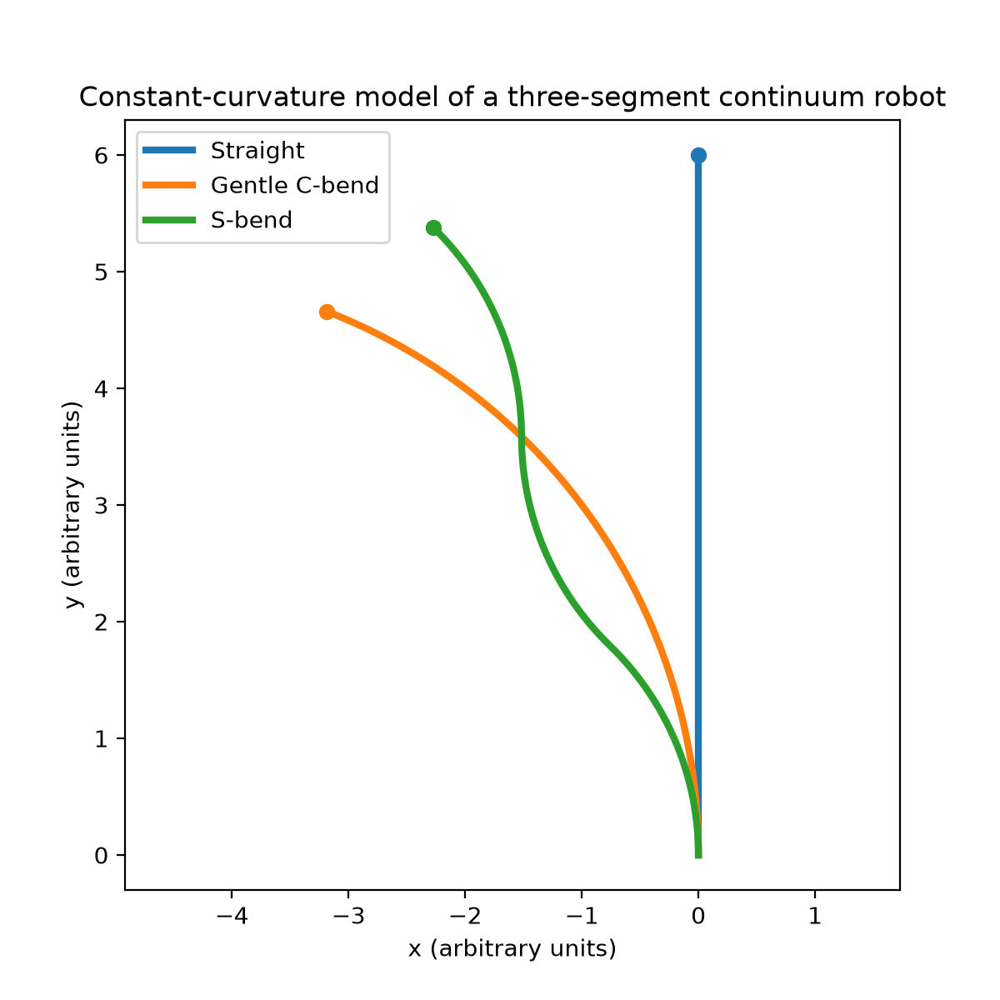
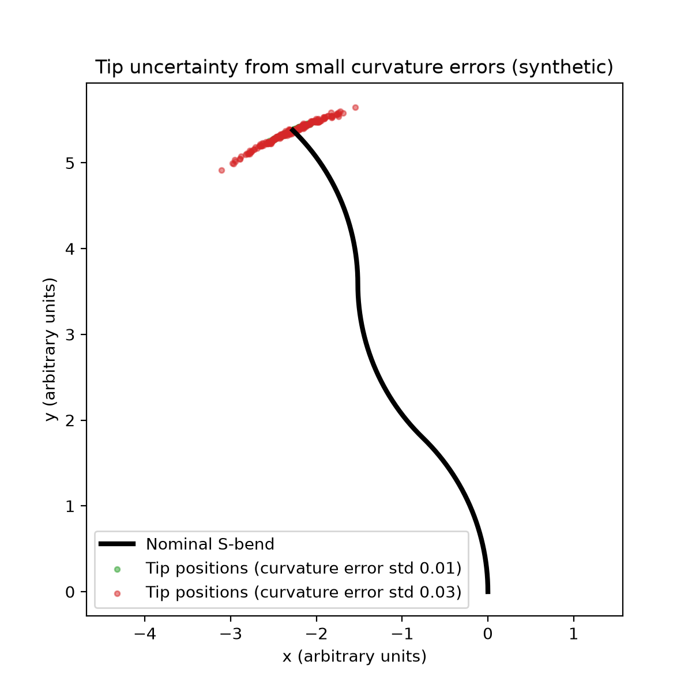

# Continuum Bending Visualizer

A small Python model of a planar continuum robot, built from segments that each bend in a circular arc. It draws example shapes, then shows how small errors in the curvature values move the robot's tip.

## Why this exists

Continuum robots have no rigid joints, so their shape cannot be read from joint encoders. It has to be sensed, for example with fiber-optic or strain sensors. This project models the simplest version of that problem. If a shape sensor reports each segment's curvature with a small error, how far off is the tip? It is a software-only companion to my [MicroSense Fusion](https://github.com/PAMify001/microsensefusion) project, which looks at fusing noisy sensor readings.

## What it does

**Part 1: shapes.** The robot has three segments of length 2.0 each (total length 6.0). Each segment has a constant curvature (the standard "constant curvature" model). The code draws three example shapes and prints their tip positions.

| Shape | Curvatures | Tip position (x, y) |
|---|---|---|
| Straight | 0, 0, 0 | (0.00, 6.00) |
| Gentle C-bend | 0.2, 0.2, 0.2 | (-3.19, 4.66) |
| S-bend | 0.4, -0.4, 0.4 | (-2.27, 5.38) |



**Part 2: tip uncertainty.** It takes the S-bend and adds a random error to each of the three curvatures. It repeats this 200 times at two error sizes, then measures how far each tip lands from the nominal tip.

| Curvature error (std) | Mean tip error | 95th percentile | Mean as % of robot length |
|---|---|---|---|
| 0.01 (2.5% of the 0.4 bend) | 0.084 | 0.216 | 1.4% |
| 0.03 (7.5% of the 0.4 bend) | 0.268 | 0.619 | 4.5% |



## What I learnt

- Small curvature errors move the tip noticeably. A 2.5% error in curvature gave an average tip error of about 1.4% of the robot's length.
- Tripling the curvature error raised the mean tip error about 3.2 times. At these small sizes, tip error grows roughly in proportion to sensing error.
- The worst cases are much larger than the average. The 95th-percentile error was about 2.3 to 2.6 times the mean.
- The tip positions spread along a curved band, not a round cloud.

## Limitations

- This is a 2D model with the constant-curvature assumption. Real continuum robots also twist, stretch and deform under load.
- Only curvature has errors. They are independent, zero-mean Gaussian errors of the same size on every segment. Segment lengths are assumed exact.
- There is no tissue, gravity or actuation, and no real sensor data. All units are arbitrary.
- Results come from one random seed (42). Other seeds will give slightly different numbers.

## Run it

```
pip install numpy matplotlib
python continuum_bending.py
```

Close the first plot window to see the second. It saves `continuum_bending.png` and `tip_uncertainty.png` and prints the numbers above.

## Next steps

- Compare one segment against three to see how much error builds up along the robot.
- Give each segment its own error size.
- Feed it curvature estimates from the sensor-fusion project, to see how fusion changes the tip error.